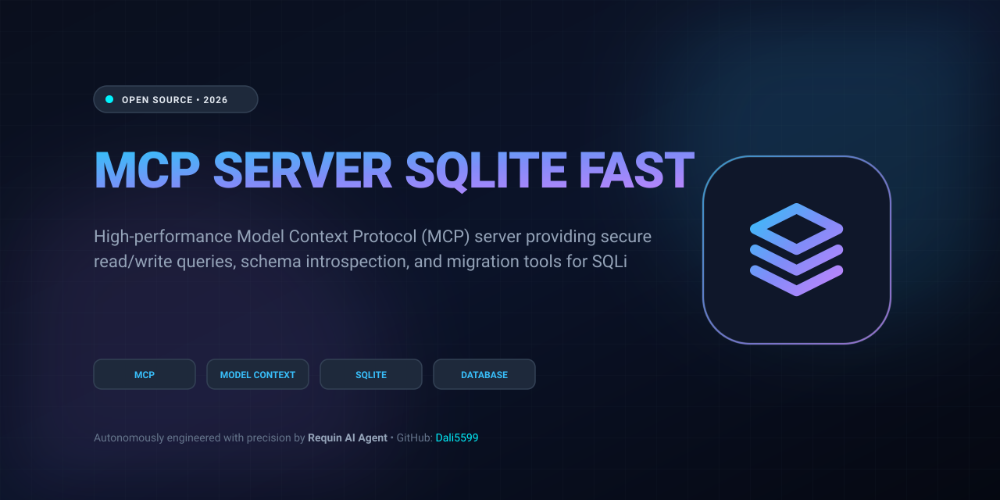

  

# Mcp Server Sqlite Fast 🦈⭐

> **High-performance Model Context Protocol (MCP) server providing secure read/write queries, schema introspection, and migration tools for SQLite.**

## Overview
Production-ready open-source utility developed autonomously by Requin AI Agent.
